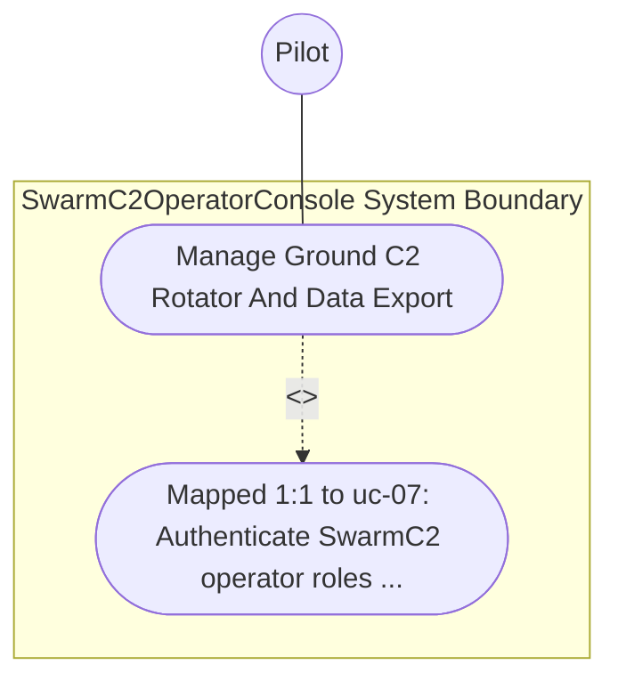

| Attribute | Specification Detail |
| :--- | :--- |
| **Issue ID** | #30 |
| **Title** | Use Case 07: Manage Ground C2 Rotator And Data Export |
| **Type** | use-case |
| **Primary Actor** | Pilot |
| **Scope** | SwarmC2OperatorConsole |
| **Level** | User Goal |
| **Generation Mode** | subagent |
| **Specification Source** | [schema/model.sysml](../../schema/model.sysml) |

# Use Case 07: Manage Ground C2 Rotator And Data Export

## UML Diagrams

## 1. Actors
- `Pilot`
- `PayloadOperator`

## 2. Preconditions
- `SwarmC2OperatorConsole` is initialized and ready to enforce `Maintain resilient 4.4-5.0 GHz C2 tracking across OMNI/DIR/200.0 m fiber paths and interoperable tactical reporting.`.
- `Pilot` holds authorized operational access to `SwarmC2OperatorConsole`.

## 3. Trigger
- Maintain resilient 4.4-5.0 GHz C2 tracking across OMNI/DIR/200.0 m fiber paths and interoperable tactical reporting.

## 4. Main Success Scenario
1. Mapped 1:1 to uc-07: Authenticate SwarmC2 operator roles (>= 8 char), enforce ESD and >= 10.0 m separation, calibrate Antenna Rotator (0.5 deg step / Auto Follow) before touching UAV, plan 50.0-3000.0 m / >= 300.0 m loiter missions, and export 5W/CFF to ATAK/SitaWare HQ/DELTA.

## 5. Alternate and Exception Flows
- Precondition guard failure in `SwarmC2OperatorConsole`:
  - `SwarmC2OperatorConsole` rejects the `Manage Ground C2 Rotator And Data Export` request without partial state mutation and reports diagnostic status to `Pilot`.
- Invariant violation while enforcing `Maintain resilient 4.4-5.0 GHz C2 tracking across OMNI/DIR/200.0 m fiber paths and interoperable tactical reporting.`:
  - `SwarmC2OperatorConsole` aborts `Manage Ground C2 Rotator And Data Export` execution, preserves prior verified state, and notifies `Pilot`.

## 6. Postconditions
- `SwarmC2OperatorConsole` satisfies declared objective `Maintain resilient 4.4-5.0 GHz C2 tracking across OMNI/DIR/200.0 m fiber paths and interoperable tactical reporting.` with all subsystem invariants intact.
- Verified `Manage Ground C2 Rotator And Data Export` completion status is recorded for `Pilot`.

## 8. Realization Matrix
| Specification Item | Type | Link / Reference |
| :--- | :--- | :--- |
| **#20** | User Story | [User Story 16: Execute Launch Go No Go And Dual Trigger](../user-stories/US-16-ExecuteLaunchGoNoGoAndDualTrigger.md) |
| **#45** | Feature | [Feature 14: [Ground Launch And Command Segment] SwarmC2OperatorConsole](../features/FEAT-14-SwarmC2OperatorConsole.md) |

## Source References
Use case operational flows and lifecycle activity references:
- System Architecture Model: `schema/model.sysml`
- Normative Systems Engineering Standard: ISO/IEC/IEEE 29148:2018 §6.4.2 Concept of Operations

Operational use case realization and traceability links derive from `schema/model.sysml` pursuant to ISO/IEC/IEEE 29148.
