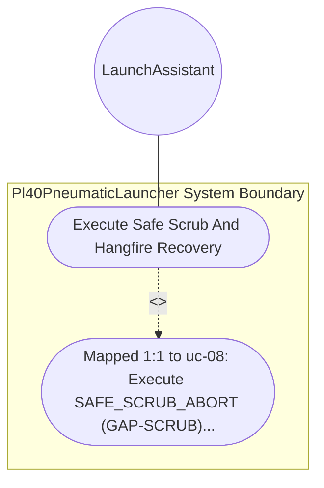

| Attribute | Specification Detail |
| :--- | :--- |
| **Issue ID** | #31 |
| **Title** | Use Case 08: Execute Safe Scrub And Hangfire Recovery |
| **Type** | use-case |
| **Primary Actor** | LaunchAssistant |
| **Scope** | Pl40PneumaticLauncher |
| **Level** | User Goal |
| **Generation Mode** | subagent |
| **Specification Source** | [schema/model.sysml](../../schema/model.sysml) |

# Use Case 08: Execute Safe Scrub And Hangfire Recovery

## UML Diagrams

## 1. Actors
- `LaunchAssistant`
- `Pilot`

## 2. Preconditions
- `Pl40PneumaticLauncher` is initialized and ready to enforce `Eliminate stored pneumatic and ordnance energy safely prior to crew approach after any launch abort or hangfire.`.
- `LaunchAssistant` holds authorized operational access to `Pl40PneumaticLauncher`.

## 3. Trigger
- Eliminate stored pneumatic and ordnance energy safely prior to crew approach after any launch abort or hangfire.

## 4. Main Success Scenario
1. Mapped 1:1 to uc-08: Execute SAFE_SCRUB_ABORT (GAP-SCRUB) after RBF #3 removal, Main Valve 4 opening, or launch hangfire by safing ESAD, bleeding PL-40 pressure, reinserting red safety pin, and restoring RBF #3 prior to RBF #2 removal.

## 5. Alternate and Exception Flows
- Precondition guard failure in `Pl40PneumaticLauncher`:
  - `Pl40PneumaticLauncher` rejects the `Execute Safe Scrub And Hangfire Recovery` request without partial state mutation and reports diagnostic status to `LaunchAssistant`.
- Invariant violation while enforcing `Eliminate stored pneumatic and ordnance energy safely prior to crew approach after any launch abort or hangfire.`:
  - `Pl40PneumaticLauncher` aborts `Execute Safe Scrub And Hangfire Recovery` execution, preserves prior verified state, and notifies `LaunchAssistant`.

## 6. Postconditions
- `Pl40PneumaticLauncher` satisfies declared objective `Eliminate stored pneumatic and ordnance energy safely prior to crew approach after any launch abort or hangfire.` with all subsystem invariants intact.
- Verified `Execute Safe Scrub And Hangfire Recovery` completion status is recorded for `LaunchAssistant`.

## 8. Realization Matrix
| Specification Item | Type | Link / Reference |
| :--- | :--- | :--- |
| **#21** | User Story | [User Story 17: Depressurize And Scrub Pl40 Launcher](../user-stories/US-17-DepressurizeAndScrubPl40Launcher.md) |
| **#44** | Feature | [Feature 13: [Ground Launch And Command Segment] Pl40PneumaticLauncher](../features/FEAT-13-Pl40PneumaticLauncher.md) |

## Source References
Use case operational flows and lifecycle activity references:
- System Architecture Model: `schema/model.sysml`
- Normative Systems Engineering Standard: ISO/IEC/IEEE 29148:2018 §6.4.2 Concept of Operations

Operational use case realization and traceability links derive from `schema/model.sysml` pursuant to ISO/IEC/IEEE 29148.
