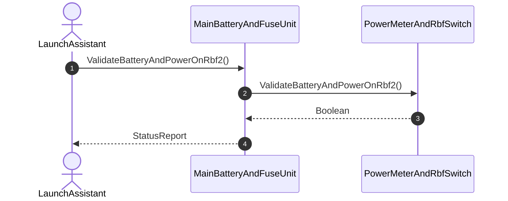

| Attribute | Specification Detail |
| :--- | :--- |
| **Issue ID** | #5 |
| **Title** | User Story 01: Validate Battery And Power On Rbf2 |
| **Type** | user-story |
| **Parent Epic** | [EPIC-02-AirframePowerAndPropulsion](../epics/EPIC-02-AirframePowerAndPropulsion.md) |
| **SysML Interaction** | `INT_01_PreflightPowerAndBit` |
| **SysML Test Case** | `Test_ValidateBatteryAndPowerOnRbf2` |
| **Generation Mode** | subagent |
| **Specification Source** | [schema/model.sysml](../../schema/model.sysml) |

# User Story 01: Validate Battery And Power On Rbf2

## User Story

As a `LaunchAssistant`, I want to invoke `ValidateBatteryAndPowerOnRbf2(in packVoltageV: Real, in rbf1Removed: Boolean, in propFoldedRearward: Boolean, in rbf3StillInstalled: Boolean, out busEnergized: Boolean)` on `PowerMeterAndRbfSwitch`, so that Mapped 1:1 to us-01: ESD touch, RBF #1 removal, rear prop fold, 49.0-50.0 V pack verify, RBF #2 removal energizing 36.0-50.4 V bus, Cube orange+ boot, RPI CM5 to ESAD 0xB0 WELCOME and 0x11 PBIT (< 50.0 V) with RBF #3 still installed (GAP-06), pitot 3.0/10.0 m/s check, RM3100 and HV6160 sweep.

## Architectural Realization (3-Layer Definition of Done)

### Layer 1: Domain State & Data Model
- Domain state attributes on `PowerMeterAndRbfSwitch`: `rbfKeyId: String`, `busVoltageMinV: Real`, `busVoltageMaxV: Real`, `trunkHarnessLengthCm: Real`, `rbf2RemovedPowersOn: Boolean`, `pullRbf2BeforeRbf3: Boolean`.
- Action `ValidateBatteryAndPowerOnRbf2` typed data contract: input arguments (`packVoltageV: Real`, `rbf1Removed: Boolean`, `propFoldedRearward: Boolean`, `rbf3StillInstalled: Boolean`), output values (`busEnergized: Boolean`).
- Declared lifecycle state model: `UavFlightLifecycleState`, `PreFlightCheck`, `CatapultLaunch`, `CruiseAndLoiter`, `TargetTrackAndDive`, `EmergencyAbortOrRtb`, `SafePostFlightShutdown`.

### Layer 2: Logic & State Management
- Behavioral execution contract: invokes `ValidateBatteryAndPowerOnRbf2(in packVoltageV: Real, in rbf1Removed: Boolean, in propFoldedRearward: Boolean, in rbf3StillInstalled: Boolean, out busEnergized: Boolean)` on `PowerMeterAndRbfSwitch` with atomic precondition verification.
- State transition management: `PreFlightCheck -> CatapultLaunch` (trigger `launchAuthorizedAndCarriageReleased`).
- Formal constraints and requirements enforced: `MainBatteryPreFlightVoltageConstraint (in packVoltageV : Real && in busVoltageV : Real && attribute invariantExpr : String = "packVoltageV >= 49.0 and packVoltageV <= 50.0 and busVoltageV >= 36.0 and busVoltageV <= 50.4")`, `BingoEnergyReserveConstraint (in reserveRatio : Real && attribute invariantExpr : String = "reserveRatio >= 0.20")`, `FlightEnvelopeSpeedConstraint (in airspeedMs : Real && in engagementActive : Boolean && attribute invariantExpr : String = "airspeedMs >= 24.0 and airspeedMs <= 80.0 and (not engagementActive or airspeedMs <= 55.0)")`, `EpsEsadZeroBrownoutMarginConstraint (in epsEsadOutV : Real && attribute invariantExpr : String = "epsEsadOutV >= 14.0 and epsEsadOutV <= 32.0")`, `ProductionNoParachuteConstraint (in rndRecoveryOptionInstalled : Boolean && attribute invariantExpr : String = "rndRecoveryOptionInstalled == false")`, `REQ_L_01`, `REQ_L_02`, `REQ_H_01`, `REQ_H_02`, `REQ_UCA_01`, `REQ_UCA_02`, `REQ_SC_01`, `REQ_SC_02`, `REQ_SC_03`, `REQ_SC_04`, `REQ_SAF_01`, `REQ_SAF_02`, `REQ_SAF_05`.

### Layer 3: Presentation & Actuator Interface Binding
- Component port bindings on `PowerMeterAndRbfSwitch`: `mainDcIn: MainBatteryDcInPort (in)`, `escDriveOut: EscDriveHarnessOutPort (inout)`, `trunkDcOut970cm: TrunkDcPowerOutPort (out)`, `can1Tap: Can1PowerTapPort (inout)`.
- Interaction binding (`INT_01_PreflightPowerAndBit`): routes `ValidateBatteryAndPowerOnRbf2` invocation from `LaunchAssistant` to `PowerMeterAndRbfSwitch` and returns `Boolean`.
- Diagnostic fault surface: reports deterministic rejection diagnostics to `LaunchAssistant` across the declared interface boundary when guard or invariant checks fail.

## UML Sequence Diagram

## Acceptance Criteria (BDD)
- [ ] AC-US-01-01: Given `PowerMeterAndRbfSwitch` is in declared state `PreFlightCheck` with typed input arguments (`packVoltageV: Real`, `rbf1Removed: Boolean`, `propFoldedRearward: Boolean`, `rbf3StillInstalled: Boolean`), When `LaunchAssistant` invokes `ValidateBatteryAndPowerOnRbf2` on `PowerMeterAndRbfSwitch`, Then `PowerMeterAndRbfSwitch` validates and binds the request against `PowerMeterAndRbfSwitch` domain state (`rbfKeyId: String`, `busVoltageMinV: Real`, `busVoltageMaxV: Real`, `trunkHarnessLengthCm: Real`, `rbf2RemovedPowersOn: Boolean`, `pullRbf2BeforeRbf3: Boolean`) and transitions to `CatapultLaunch`.
- [ ] AC-US-01-02: Given `PowerMeterAndRbfSwitch` active state management during `ValidateBatteryAndPowerOnRbf2`, When `PowerMeterAndRbfSwitch` evaluates formal constraint `MainBatteryPreFlightVoltageConstraint (in packVoltageV : Real && in busVoltageV : Real && attribute invariantExpr : String = "packVoltageV >= 49.0 and packVoltageV <= 50.0 and busVoltageV >= 36.0 and busVoltageV <= 50.4")`, Then `PowerMeterAndRbfSwitch` verifies constraint satisfaction before committing state updates.
- [ ] AC-US-01-03: Given `PowerMeterAndRbfSwitch` active state management during `ValidateBatteryAndPowerOnRbf2`, When `PowerMeterAndRbfSwitch` evaluates formal constraint `BingoEnergyReserveConstraint (in reserveRatio : Real && attribute invariantExpr : String = "reserveRatio >= 0.20")`, Then `PowerMeterAndRbfSwitch` verifies constraint satisfaction before committing state updates.
- [ ] AC-US-01-04: Given `PowerMeterAndRbfSwitch` active state management during `ValidateBatteryAndPowerOnRbf2`, When `PowerMeterAndRbfSwitch` evaluates formal constraint `FlightEnvelopeSpeedConstraint (in airspeedMs : Real && in engagementActive : Boolean && attribute invariantExpr : String = "airspeedMs >= 24.0 and airspeedMs <= 80.0 and (not engagementActive or airspeedMs <= 55.0)")`, Then `PowerMeterAndRbfSwitch` verifies constraint satisfaction before committing state updates.
- [ ] AC-US-01-05: Given `PowerMeterAndRbfSwitch` active state management during `ValidateBatteryAndPowerOnRbf2`, When `PowerMeterAndRbfSwitch` evaluates formal constraint `EpsEsadZeroBrownoutMarginConstraint (in epsEsadOutV : Real && attribute invariantExpr : String = "epsEsadOutV >= 14.0 and epsEsadOutV <= 32.0")`, Then `PowerMeterAndRbfSwitch` verifies constraint satisfaction before committing state updates.
- [ ] AC-US-01-06: Given `PowerMeterAndRbfSwitch` active state management during `ValidateBatteryAndPowerOnRbf2`, When `PowerMeterAndRbfSwitch` evaluates formal constraint `ProductionNoParachuteConstraint (in rndRecoveryOptionInstalled : Boolean && attribute invariantExpr : String = "rndRecoveryOptionInstalled == false")`, Then `PowerMeterAndRbfSwitch` verifies constraint satisfaction before committing state updates.
- [ ] AC-US-01-07: Given `PowerMeterAndRbfSwitch` ingress port binding (`mainDcIn: MainBatteryDcInPort`, `escDriveOut: EscDriveHarnessOutPort`, `can1Tap: Can1PowerTapPort`), When `PowerMeterAndRbfSwitch` completes `ValidateBatteryAndPowerOnRbf2`, Then `PowerMeterAndRbfSwitch` materializes verified output (`busEnergized: Boolean`) and delivers `Boolean` across egress port (`escDriveOut: EscDriveHarnessOutPort`, `trunkDcOut970cm: TrunkDcPowerOutPort`, `can1Tap: Can1PowerTapPort`) to `LaunchAssistant`.
- [ ] AC-US-01-08: Given violated formal constraint `MainBatteryPreFlightVoltageConstraint (in packVoltageV : Real && in busVoltageV : Real && attribute invariantExpr : String = "packVoltageV >= 49.0 and packVoltageV <= 50.0 and busVoltageV >= 36.0 and busVoltageV <= 50.4")`, When `LaunchAssistant` invokes `ValidateBatteryAndPowerOnRbf2` on `PowerMeterAndRbfSwitch`, Then `PowerMeterAndRbfSwitch` rejects the request without partial state mutation, preserves prior verified state, and emits a deterministic fault diagnostic across the interface binding.

## Required Features
- [ ] #33 - [Feature 02: [Airframe Power And Propulsion] MainBatteryAndFuseUnit](../features/FEAT-02-MainBatteryAndFuseUnit.md)
- [ ] #34 - [Feature 03: [Airframe Power And Propulsion] PowerMeterAndRbfSwitch](../features/FEAT-03-PowerMeterAndRbfSwitch.md)

## Source References
Operational concept definitions and system sequence interaction models:
- System Architecture Model: `schema/model.sysml`
- Normative Systems Engineering Standard: ISO/IEC/IEEE 29148:2018 §6.4.2 Concept of Operations

Authoritative user story flows and interaction lifelines derive from `schema/model.sysml` pursuant to ISO/IEC/IEEE 29148.
