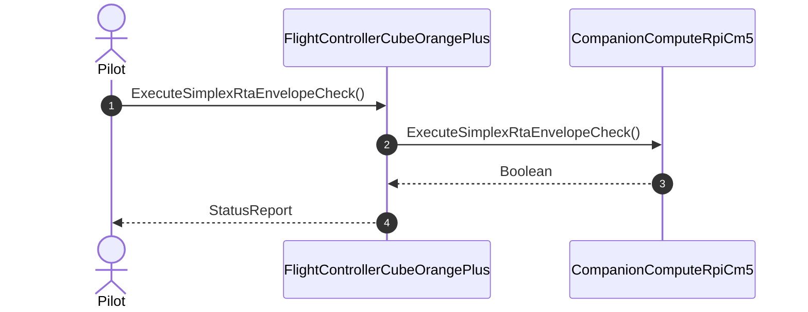

| Attribute | Specification Detail |
| :--- | :--- |
| **Issue ID** | #9 |
| **Title** | User Story 05: Execute Simplex Rta Envelope Check |
| **Type** | user-story |
| **Parent Epic** | [EPIC-03-AvionicsGuidanceAndControl](../epics/EPIC-03-AvionicsGuidanceAndControl.md) |
| **SysML Interaction** | `INT_04_AutopilotRtaAndSurfaceActuation` |
| **SysML Test Case** | `Test_ExecuteSimplexRtaEnvelopeCheck` |
| **Generation Mode** | subagent |
| **Specification Source** | [schema/model.sysml](../../schema/model.sysml) |

# User Story 05: Execute Simplex Rta Envelope Check

## User Story

As a `Pilot`, I want to invoke `ExecuteSimplexRtaEnvelopeCheck(in airspeedMs: Real, in diveAngleDeg: Real, in linkLossSec: Real, in esadBusHealthy: Boolean, out clampEngagementSpeed: Boolean, out triggerRtlFailsafe: Boolean, out disarmEsadRequested: Boolean)` on `CompanionComputeRpiCm5`, so that Mapped 1:1 to us-04: Cube orange+ EKF2 and software Simplex RTA command tail fins #1-#4 (CAN 1 4x 120 cm stubs) and wing panels #5-#8 (CAN 2 splitter daisy-chain), clamping 55.0 m/s engagement cap and 80.0 m/s VNE (GAP-02).

## Architectural Realization (3-Layer Definition of Done)

### Layer 1: Domain State & Data Model
- Domain state attributes on `CompanionComputeRpiCm5`: `computeModel: String`, `rs485BaudBps: Integer`, `esadPollFrequencyHz: Real`, `esadPollPeriodSec: Real`, `esadReplyMaxLatencyMs: Real`, `esadIncompleteTimeoutMs: Real`, `crcPolynomial: String`, `dscIn1PulseFreqHz: Real`, `dscIn1PulseCount: Integer`.
- Action `ExecuteSimplexRtaEnvelopeCheck` typed data contract: input arguments (`airspeedMs: Real`, `diveAngleDeg: Real`, `linkLossSec: Real`, `esadBusHealthy: Boolean`), output values (`clampEngagementSpeed: Boolean`, `triggerRtlFailsafe: Boolean`, `disarmEsadRequested: Boolean`).
- Declared lifecycle state model: `RtaEnvelopeMonitorState`, `NominalPrimaryEnvelope`, `AirspeedDiveCapClamped`, `EsadBusWatchdogFaultFallback`, `CriticalBatteryOrGeofenceRtb`.

### Layer 2: Logic & State Management
- Behavioral execution contract: invokes `ExecuteSimplexRtaEnvelopeCheck(in airspeedMs: Real, in diveAngleDeg: Real, in linkLossSec: Real, in esadBusHealthy: Boolean, out clampEngagementSpeed: Boolean, out triggerRtlFailsafe: Boolean, out disarmEsadRequested: Boolean)` on `CompanionComputeRpiCm5` with atomic precondition verification.
- State transition management: `NominalPrimaryEnvelope -> AirspeedDiveCapClamped` (trigger `airspeedAbove55MsInDive`).
- Formal constraints and requirements enforced: `PitotPreflightCalibrationConstraint (in calmAirMs : Real && in blownAirMs : Real && attribute invariantExpr : String = "calmAirMs <= 3.0 and blownAirMs >= 10.0")`, `CanTopologyIsolationConstraint (in finCount : Integer && in wingCount : Integer && in magCount : Integer && in stubLenCm : Real && attribute invariantExpr : String = "finCount == 4 and wingCount == 4 and magCount == 2 and stubLenCm == 120.0")`, `SimplexRtaSoftwareHostingConstraint (in standaloneRtaBoxCount : Integer && in rtaHostedOnCubeOrangePlus : Boolean && attribute invariantExpr : String = "standaloneRtaBoxCount == 0 and rtaHostedOnCubeOrangePlus == true")`, `REQ_L_03`, `REQ_H_03`, `REQ_UCA_03`, `REQ_UCA_04`, `REQ_SC_05`, `REQ_SC_06`, `REQ_SC_07`, `REQ_SC_08`, `REQ_SAF_08`, `REQ_SAF_09`.

### Layer 3: Presentation & Actuator Interface Binding
- Component port bindings on `CompanionComputeRpiCm5`: `serialFc: UartSerialPort (inout)`, `ethSwitch: EthernetFabricPort (inout)`, `esadOcControl: EsadOcControlBundlePort (inout)`.
- Interaction binding (`INT_04_AutopilotRtaAndSurfaceActuation`): routes `ExecuteSimplexRtaEnvelopeCheck` invocation from `Pilot` to `CompanionComputeRpiCm5` and returns `Boolean`.
- Diagnostic fault surface: reports deterministic rejection diagnostics to `Pilot` across the declared interface boundary when guard or invariant checks fail.

## UML Sequence Diagram

## Acceptance Criteria (BDD)
- [ ] AC-US-05-01: Given `CompanionComputeRpiCm5` is in declared state `NominalPrimaryEnvelope` with typed input arguments (`airspeedMs: Real`, `diveAngleDeg: Real`, `linkLossSec: Real`, `esadBusHealthy: Boolean`), When `Pilot` invokes `ExecuteSimplexRtaEnvelopeCheck` on `CompanionComputeRpiCm5`, Then `CompanionComputeRpiCm5` validates and binds the request against `CompanionComputeRpiCm5` domain state (`computeModel: String`, `rs485BaudBps: Integer`, `esadPollFrequencyHz: Real`, `esadPollPeriodSec: Real`, `esadReplyMaxLatencyMs: Real`, `esadIncompleteTimeoutMs: Real`, `crcPolynomial: String`, `dscIn1PulseFreqHz: Real`, `dscIn1PulseCount: Integer`) and transitions to `AirspeedDiveCapClamped`.
- [ ] AC-US-05-02: Given `CompanionComputeRpiCm5` active state management during `ExecuteSimplexRtaEnvelopeCheck`, When `CompanionComputeRpiCm5` evaluates formal constraint `PitotPreflightCalibrationConstraint (in calmAirMs : Real && in blownAirMs : Real && attribute invariantExpr : String = "calmAirMs <= 3.0 and blownAirMs >= 10.0")`, Then `CompanionComputeRpiCm5` verifies constraint satisfaction before committing state updates.
- [ ] AC-US-05-03: Given `CompanionComputeRpiCm5` active state management during `ExecuteSimplexRtaEnvelopeCheck`, When `CompanionComputeRpiCm5` evaluates formal constraint `CanTopologyIsolationConstraint (in finCount : Integer && in wingCount : Integer && in magCount : Integer && in stubLenCm : Real && attribute invariantExpr : String = "finCount == 4 and wingCount == 4 and magCount == 2 and stubLenCm == 120.0")`, Then `CompanionComputeRpiCm5` verifies constraint satisfaction before committing state updates.
- [ ] AC-US-05-04: Given `CompanionComputeRpiCm5` active state management during `ExecuteSimplexRtaEnvelopeCheck`, When `CompanionComputeRpiCm5` evaluates formal constraint `SimplexRtaSoftwareHostingConstraint (in standaloneRtaBoxCount : Integer && in rtaHostedOnCubeOrangePlus : Boolean && attribute invariantExpr : String = "standaloneRtaBoxCount == 0 and rtaHostedOnCubeOrangePlus == true")`, Then `CompanionComputeRpiCm5` verifies constraint satisfaction before committing state updates.
- [ ] AC-US-05-05: Given `CompanionComputeRpiCm5` requirement allocation for `ExecuteSimplexRtaEnvelopeCheck`, When `CompanionComputeRpiCm5` verifies formal requirement `REQ_L_03`, Then `CompanionComputeRpiCm5` confirms normative requirement satisfaction across execution.
- [ ] AC-US-05-06: Given `CompanionComputeRpiCm5` requirement allocation for `ExecuteSimplexRtaEnvelopeCheck`, When `CompanionComputeRpiCm5` verifies formal requirement `REQ_H_03`, Then `CompanionComputeRpiCm5` confirms normative requirement satisfaction across execution.
- [ ] AC-US-05-07: Given `CompanionComputeRpiCm5` ingress port binding (`serialFc: UartSerialPort`, `ethSwitch: EthernetFabricPort`, `esadOcControl: EsadOcControlBundlePort`), When `CompanionComputeRpiCm5` completes `ExecuteSimplexRtaEnvelopeCheck`, Then `CompanionComputeRpiCm5` materializes verified output (`clampEngagementSpeed: Boolean`, `triggerRtlFailsafe: Boolean`, `disarmEsadRequested: Boolean`) and delivers `Boolean` across egress port (`serialFc: UartSerialPort`, `ethSwitch: EthernetFabricPort`, `esadOcControl: EsadOcControlBundlePort`) to `Pilot`.
- [ ] AC-US-05-08: Given violated formal constraint `PitotPreflightCalibrationConstraint (in calmAirMs : Real && in blownAirMs : Real && attribute invariantExpr : String = "calmAirMs <= 3.0 and blownAirMs >= 10.0")`, When `Pilot` invokes `ExecuteSimplexRtaEnvelopeCheck` on `CompanionComputeRpiCm5`, Then `CompanionComputeRpiCm5` rejects the request without partial state mutation, preserves prior verified state, and emits a deterministic fault diagnostic across the interface binding.

## Required Features
- [ ] #37 - [Feature 06: [Avionics Guidance And Control] FlightControllerCubeOrangePlus](../features/FEAT-06-FlightControllerCubeOrangePlus.md)
- [ ] #38 - [Feature 07: [Avionics Guidance And Control] CompanionComputeRpiCm5](../features/FEAT-07-CompanionComputeRpiCm5.md)

## Source References
Operational concept definitions and system sequence interaction models:
- System Architecture Model: `schema/model.sysml`
- Normative Systems Engineering Standard: ISO/IEC/IEEE 29148:2018 §6.4.2 Concept of Operations

Authoritative user story flows and interaction lifelines derive from `schema/model.sysml` pursuant to ISO/IEC/IEEE 29148.
