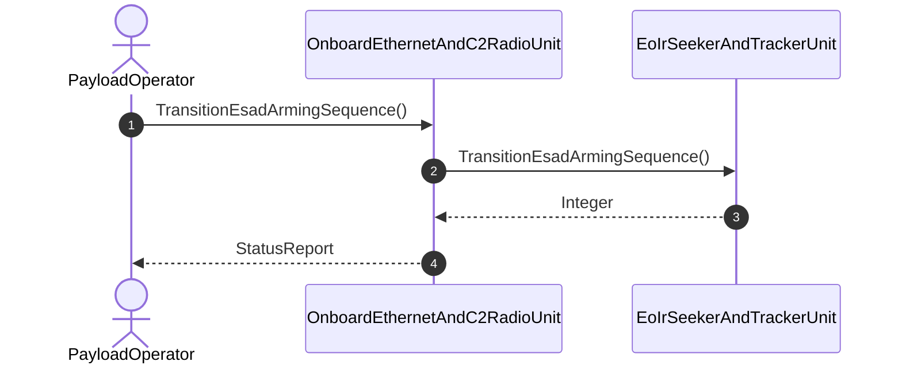

| Attribute | Specification Detail |
| :--- | :--- |
| **Issue ID** | #15 |
| **Title** | User Story 11: Transition Esad Arming Sequence |
| **Type** | user-story |
| **Parent Epic** | [EPIC-04-MissionPayloadsCommsAndOrdnanceSafety](../epics/EPIC-04-MissionPayloadsCommsAndOrdnanceSafety.md) |
| **SysML Interaction** | `INT_07_EsadDualBarrierArmAndDetonation` |
| **SysML Test Case** | `Test_TransitionEsadArmingSequence` |
| **Generation Mode** | subagent |
| **Specification Source** | [schema/model.sysml](../../schema/model.sysml) |

# User Story 11: Transition Esad Arming Sequence

## User Story

As a `PayloadOperator`, I want to invoke `TransitionEsadArmingSequence(in rbf3RemovedAfterPower: Boolean, in ss1LaunchSensed: Boolean, in ss2SafeDistExceeded: Boolean, in dscIn1Valid: Boolean, out armState: Integer, out hvChargedV: Real)` on `EoIrSeekerAndTrackerUnit`, so that Mapped 1:1 to us-07: RPI CM5 OC Master executes 100 Hz RS-485 0x10 EXCHANGE (CRC-16 XModem), confirms SS1 launch accel, SS2 Safe Distance Exceed == 1 (GAP-07), 14.0 V GE_POW health (GAP-01), Stage 2 DSC_IN1 1 kHz 2-pulse, 0x12 HIGHVOLTAGE charge (0-1800 V), and Sensor Board J102->J1 ORed IRQ_L -> J401 detonation into <= 5.0 kg warhead.

## Architectural Realization (3-Layer Definition of Done)

### Layer 1: Domain State & Data Model
- Domain state attributes on `EoIrSeekerAndTrackerUnit`: `gimbalModel: String`, `trackerComputeModel: String`, `videoWidthPx: Integer`, `videoHeightPx: Integer`, `zoomFactor: Real`, `pitchMinDeg: Real`, `pitchMaxDeg: Real`, `yawRollMinDeg: Real`, `yawRollMaxDeg: Real`, `engagementSpeedCapMs: Real`, `trackHoldMinSec: Real`, `trackHoldMaxSec: Real`, `maxTargetElevAtStartDeg: Real`, `shallowApproachAngleDeg: Real`, `terminalCepMaxM: Real`, `terminalCepMaxCm: Real`.
- Action `TransitionEsadArmingSequence` typed data contract: input arguments (`rbf3RemovedAfterPower: Boolean`, `ss1LaunchSensed: Boolean`, `ss2SafeDistExceeded: Boolean`, `dscIn1Valid: Boolean`), output values (`armState: Integer`, `hvChargedV: Real`).
- Declared lifecycle state model: `EsadSafeArmState`, `SafePowerOff`, `BootAndPbit`, `SafeRbfInstalled`, `FaultLockout`, `SafeRbfRemoved`, `ArmStage1TimerWait`, `ArmStage2Armed`, `HvChargedReady`, `DetonatedOrAborted`, `PaceC2LinkState`, `AlternateDtcOmniLocal`, `PrimaryDtcDirTracking`, `ContingencyGnssDeniedDrFlight`, `EmergencyLostLinkRtlHolding`.

### Layer 2: Logic & State Management
- Behavioral execution contract: invokes `TransitionEsadArmingSequence(in rbf3RemovedAfterPower: Boolean, in ss1LaunchSensed: Boolean, in ss2SafeDistExceeded: Boolean, in dscIn1Valid: Boolean, out armState: Integer, out hvChargedV: Real)` on `EoIrSeekerAndTrackerUnit` with atomic precondition verification.
- State transition management: `SafePowerOff -> BootAndPbit` (trigger `eps14VAppliedWithRbf3Installed`).
- Formal constraints and requirements enforced: `EsadInputVoltageAndBrownoutConstraint (in vdcInV : Real && attribute invariantExpr : String = "vdcInV >= 14.0 and vdcInV <= 32.0")`, `EsadRs485ProtocolTimingConstraint (in baudBps : Integer && in pollHz : Real && in replyMs : Real && in timeoutMs : Real && attribute invariantExpr : String = "baudBps == 115200 and pollHz == 100.0 and replyMs <= 5.0 and timeoutMs <= 10.0")`, `EsadRbf3PowerBeforePullConstraint (in uavPoweredBeforeRbf3Pull : Boolean && in umbResistanceOhm : Real && attribute invariantExpr : String = "uavPoweredBeforeRbf3Pull == true and umbResistanceOhm < 0.5")`, `EsadSafeDistanceExceedConstraint (in safeDistanceExceeded : Boolean && in ss1Sensed : Boolean && attribute invariantExpr : String = "safeDistanceExceeded == true and ss1Sensed == true")`, `WarheadMassAndPbitHvSafetyConstraint (in warheadMassKg : Real && in pbitHvV : Real && in fireHvV : Real && attribute invariantExpr : String = "warheadMassKg <= 5.0 and pbitHvV < 50.0 and fireHvV >= 0.0 and fireHvV <= 1800.0")`, `EngagementSpeedAndTrackHoldConstraint (in airspeedMs : Real && in trackHoldSec : Real && in cepM : Real && attribute invariantExpr : String = "airspeedMs <= 55.0 and trackHoldSec >= 2.0 and trackHoldSec <= 5.0 and cepM <= 0.5")`, `REQ_L_04`, `REQ_H_04`, `REQ_H_05`, `REQ_UCA_05`, `REQ_UCA_06`, `REQ_UCA_07`, `REQ_SC_09`, `REQ_SC_10`, `REQ_SC_11`, `REQ_SC_12`, `REQ_SAF_04`, `REQ_SAF_06`, `REQ_SAF_07`, `REQ_SAF_10`.

### Layer 3: Presentation & Actuator Interface Binding
- Component port bindings on `EoIrSeekerAndTrackerUnit`: `gimbalPowerIn: RegulatedRailInPort (in)`, `serialFc: UartSerialPort (inout)`, `ethSwitch: EthernetFabricPort (inout)`.
- Interaction binding (`INT_07_EsadDualBarrierArmAndDetonation`): routes `TransitionEsadArmingSequence` invocation from `PayloadOperator` to `EoIrSeekerAndTrackerUnit` and returns `Integer`.
- Diagnostic fault surface: reports deterministic rejection diagnostics to `PayloadOperator` across the declared interface boundary when guard or invariant checks fail.

## UML Sequence Diagram

## Acceptance Criteria (BDD)
- [ ] AC-US-11-01: Given `EoIrSeekerAndTrackerUnit` is in declared state `SafePowerOff` with typed input arguments (`rbf3RemovedAfterPower: Boolean`, `ss1LaunchSensed: Boolean`, `ss2SafeDistExceeded: Boolean`, `dscIn1Valid: Boolean`), When `PayloadOperator` invokes `TransitionEsadArmingSequence` on `EoIrSeekerAndTrackerUnit`, Then `EoIrSeekerAndTrackerUnit` validates and binds the request against `EoIrSeekerAndTrackerUnit` domain state (`gimbalModel: String`, `trackerComputeModel: String`, `videoWidthPx: Integer`, `videoHeightPx: Integer`, `zoomFactor: Real`, `pitchMinDeg: Real`, `pitchMaxDeg: Real`, `yawRollMinDeg: Real`, `yawRollMaxDeg: Real`, `engagementSpeedCapMs: Real`, `trackHoldMinSec: Real`, `trackHoldMaxSec: Real`, `maxTargetElevAtStartDeg: Real`, `shallowApproachAngleDeg: Real`, `terminalCepMaxM: Real`, `terminalCepMaxCm: Real`) and transitions to `BootAndPbit`.
- [ ] AC-US-11-02: Given `EoIrSeekerAndTrackerUnit` active state management during `TransitionEsadArmingSequence`, When `EoIrSeekerAndTrackerUnit` evaluates formal constraint `EsadInputVoltageAndBrownoutConstraint (in vdcInV : Real && attribute invariantExpr : String = "vdcInV >= 14.0 and vdcInV <= 32.0")`, Then `EoIrSeekerAndTrackerUnit` verifies constraint satisfaction before committing state updates.
- [ ] AC-US-11-03: Given `EoIrSeekerAndTrackerUnit` active state management during `TransitionEsadArmingSequence`, When `EoIrSeekerAndTrackerUnit` evaluates formal constraint `EsadRs485ProtocolTimingConstraint (in baudBps : Integer && in pollHz : Real && in replyMs : Real && in timeoutMs : Real && attribute invariantExpr : String = "baudBps == 115200 and pollHz == 100.0 and replyMs <= 5.0 and timeoutMs <= 10.0")`, Then `EoIrSeekerAndTrackerUnit` verifies constraint satisfaction before committing state updates.
- [ ] AC-US-11-04: Given `EoIrSeekerAndTrackerUnit` active state management during `TransitionEsadArmingSequence`, When `EoIrSeekerAndTrackerUnit` evaluates formal constraint `EsadRbf3PowerBeforePullConstraint (in uavPoweredBeforeRbf3Pull : Boolean && in umbResistanceOhm : Real && attribute invariantExpr : String = "uavPoweredBeforeRbf3Pull == true and umbResistanceOhm < 0.5")`, Then `EoIrSeekerAndTrackerUnit` verifies constraint satisfaction before committing state updates.
- [ ] AC-US-11-05: Given `EoIrSeekerAndTrackerUnit` active state management during `TransitionEsadArmingSequence`, When `EoIrSeekerAndTrackerUnit` evaluates formal constraint `EsadSafeDistanceExceedConstraint (in safeDistanceExceeded : Boolean && in ss1Sensed : Boolean && attribute invariantExpr : String = "safeDistanceExceeded == true and ss1Sensed == true")`, Then `EoIrSeekerAndTrackerUnit` verifies constraint satisfaction before committing state updates.
- [ ] AC-US-11-06: Given `EoIrSeekerAndTrackerUnit` active state management during `TransitionEsadArmingSequence`, When `EoIrSeekerAndTrackerUnit` evaluates formal constraint `WarheadMassAndPbitHvSafetyConstraint (in warheadMassKg : Real && in pbitHvV : Real && in fireHvV : Real && attribute invariantExpr : String = "warheadMassKg <= 5.0 and pbitHvV < 50.0 and fireHvV >= 0.0 and fireHvV <= 1800.0")`, Then `EoIrSeekerAndTrackerUnit` verifies constraint satisfaction before committing state updates.
- [ ] AC-US-11-07: Given `EoIrSeekerAndTrackerUnit` ingress port binding (`gimbalPowerIn: RegulatedRailInPort`, `serialFc: UartSerialPort`, `ethSwitch: EthernetFabricPort`), When `EoIrSeekerAndTrackerUnit` completes `TransitionEsadArmingSequence`, Then `EoIrSeekerAndTrackerUnit` materializes verified output (`armState: Integer`, `hvChargedV: Real`) and delivers `Integer` across egress port (`serialFc: UartSerialPort`, `ethSwitch: EthernetFabricPort`) to `PayloadOperator`.
- [ ] AC-US-11-08: Given violated formal constraint `EsadInputVoltageAndBrownoutConstraint (in vdcInV : Real && attribute invariantExpr : String = "vdcInV >= 14.0 and vdcInV <= 32.0")`, When `PayloadOperator` invokes `TransitionEsadArmingSequence` on `EoIrSeekerAndTrackerUnit`, Then `EoIrSeekerAndTrackerUnit` rejects the request without partial state mutation, preserves prior verified state, and emits a deterministic fault diagnostic across the interface binding.

## Required Features
- [ ] #41 - [Feature 10: [Mission Payloads Comms And Ordnance Safety] OnboardEthernetAndC2RadioUnit](../features/FEAT-10-OnboardEthernetAndC2RadioUnit.md)
- [ ] #42 - [Feature 11: [Mission Payloads Comms And Ordnance Safety] EoIrSeekerAndTrackerUnit](../features/FEAT-11-EoIrSeekerAndTrackerUnit.md)

## Source References
Operational concept definitions and system sequence interaction models:
- System Architecture Model: `schema/model.sysml`
- Normative Systems Engineering Standard: ISO/IEC/IEEE 29148:2018 §6.4.2 Concept of Operations

Authoritative user story flows and interaction lifelines derive from `schema/model.sysml` pursuant to ISO/IEC/IEEE 29148.
