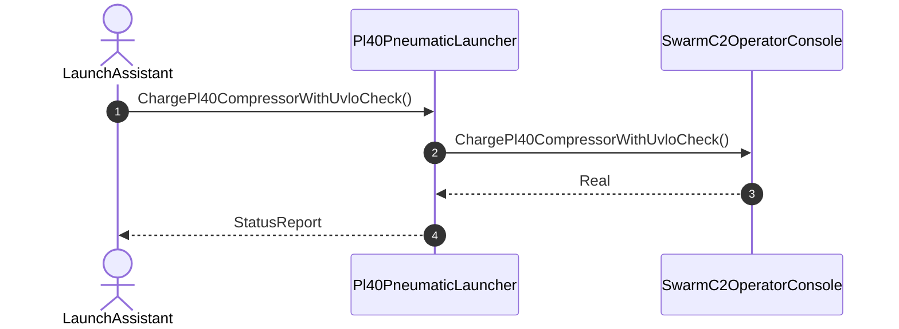

| Attribute | Specification Detail |
| :--- | :--- |
| **Issue ID** | #19 |
| **Title** | User Story 15: Charge Pl40 Compressor With Uvlo Check |
| **Type** | user-story |
| **Parent Epic** | [EPIC-05-GroundLaunchAndCommandSegment](../epics/EPIC-05-GroundLaunchAndCommandSegment.md) |
| **SysML Interaction** | `INT_03_Pl40RailChargeAndLaunchSequence` |
| **SysML Test Case** | `Test_ChargePl40CompressorWithUvloCheck` |
| **Generation Mode** | subagent |
| **Specification Source** | [schema/model.sysml](../../schema/model.sysml) |

# User Story 15: Charge Pl40 Compressor With Uvlo Check

## User Story

As a `LaunchAssistant`, I want to invoke `ChargePl40CompressorWithUvloCheck(in packVoltageV: Real, in targetPressureBar: Real, out tankPressureBar: Real, out uvloPaused: Boolean)` on `SwarmC2OperatorConsole`, so that Charge PL-40 air tank to 13.0-14.0 bar (<= 8.0 min, 0.05 bar hysteresis) while monitoring 18.0 V Makita BL1860B packs for <= 14.5 V UVLO cutoff and >= 16.0 V (5.0 s) restart.

## Architectural Realization (3-Layer Definition of Done)

### Layer 1: Domain State & Data Model
- Domain state attributes on `SwarmC2OperatorConsole`: `osPlatform: String`, `softwareSuite: String`, `passwordMinChars: Integer`, `missionNameMaxChars: Integer`, `telemetryDetectTimeoutMin: Real`, `waypointAltMinM: Real`, `altitudeSliderMaxM: Real`, `altitudeSliderStepM: Real`, `loiterRadiusMinM: Real`, `gcsFailsafeTimeoutSec: Real`, `esadSelfDestructHoldSec: Real`, `c2ExportFormats: String`.
- Action `ChargePl40CompressorWithUvloCheck` typed data contract: input arguments (`packVoltageV: Real`, `targetPressureBar: Real`), output values (`tankPressureBar: Real`, `uvloPaused: Boolean`).
- Declared lifecycle state model: `Pl40LauncherState`, `DisassembledTransport`, `AnchoredAndLeveled`, `CompressorCharging`, `UvloPause`, `ReadyAt13To14BarPinInstalled`, `DualSwitchFiring`, `RailLaunchReleased`, `ScrubbedSafeDepressurized`.

### Layer 2: Logic & State Management
- Behavioral execution contract: invokes `ChargePl40CompressorWithUvloCheck(in packVoltageV: Real, in targetPressureBar: Real, out tankPressureBar: Real, out uvloPaused: Boolean)` on `SwarmC2OperatorConsole` with atomic precondition verification.
- State transition management: `DisassembledTransport -> AnchoredAndLeveled` (trigger `railAnchoredAndLeveled12Deg`).
- Formal constraints and requirements enforced: `Pl40MassAndExitVelocityConstraint (in uavMassKg : Real && in pressureBar : Real && in exitVelMs : Real && in windMs : Real && attribute invariantExpr : String = "uavMassKg <= 30.0 and pressureBar >= 13.0 and pressureBar <= 14.0 and exitVelMs <= 25.0 and windMs <= 12.0")`, `Pl40UvloAndDualSwitchConstraint (in packVoltageV : Real && in dualHoldSec : Real && attribute invariantExpr : String = "packVoltageV > 14.5 and dualHoldSec >= 2.0")`, `SwarmC2AuthAndMissionBoundsConstraint (in passwordLen : Integer && in missionNameLen : Integer && in waypointAltM : Real && in loiterRadiusM : Real && attribute invariantExpr : String = "passwordLen >= 8 and missionNameLen <= 24 and waypointAltM >= 50.0 and waypointAltM <= 3000.0 and loiterRadiusM >= 300.0")`, `GroundCrewSeparationAndEsdConstraint (in esdGrounded : Boolean && in separationM : Real && attribute invariantExpr : String = "esdGrounded == true and separationM >= 10.0")`, `REQ_H_06`, `REQ_UCA_08`, `REQ_SC_13`, `REQ_SC_14`, `REQ_SC_15`, `REQ_SC_16`, `REQ_SAF_03`, `REQ_SAF_11`, `REQ_SAF_12`.

### Layer 3: Presentation & Actuator Interface Binding
- Component port bindings on `SwarmC2OperatorConsole`: `gcsStationPort: GcsStationControlPort (inout)`.
- Interaction binding (`INT_03_Pl40RailChargeAndLaunchSequence`): routes `ChargePl40CompressorWithUvloCheck` invocation from `LaunchAssistant` to `SwarmC2OperatorConsole` and returns `Real`.
- Diagnostic fault surface: reports deterministic rejection diagnostics to `LaunchAssistant` across the declared interface boundary when guard or invariant checks fail.

## UML Sequence Diagram

## Acceptance Criteria (BDD)
- [ ] AC-US-15-01: Given `SwarmC2OperatorConsole` is in declared state `DisassembledTransport` with typed input arguments (`packVoltageV: Real`, `targetPressureBar: Real`), When `LaunchAssistant` invokes `ChargePl40CompressorWithUvloCheck` on `SwarmC2OperatorConsole`, Then `SwarmC2OperatorConsole` validates and binds the request against `SwarmC2OperatorConsole` domain state (`osPlatform: String`, `softwareSuite: String`, `passwordMinChars: Integer`, `missionNameMaxChars: Integer`, `telemetryDetectTimeoutMin: Real`, `waypointAltMinM: Real`, `altitudeSliderMaxM: Real`, `altitudeSliderStepM: Real`, `loiterRadiusMinM: Real`, `gcsFailsafeTimeoutSec: Real`, `esadSelfDestructHoldSec: Real`, `c2ExportFormats: String`) and transitions to `AnchoredAndLeveled`.
- [ ] AC-US-15-02: Given `SwarmC2OperatorConsole` active state management during `ChargePl40CompressorWithUvloCheck`, When `SwarmC2OperatorConsole` evaluates formal constraint `Pl40MassAndExitVelocityConstraint (in uavMassKg : Real && in pressureBar : Real && in exitVelMs : Real && in windMs : Real && attribute invariantExpr : String = "uavMassKg <= 30.0 and pressureBar >= 13.0 and pressureBar <= 14.0 and exitVelMs <= 25.0 and windMs <= 12.0")`, Then `SwarmC2OperatorConsole` verifies constraint satisfaction before committing state updates.
- [ ] AC-US-15-03: Given `SwarmC2OperatorConsole` active state management during `ChargePl40CompressorWithUvloCheck`, When `SwarmC2OperatorConsole` evaluates formal constraint `Pl40UvloAndDualSwitchConstraint (in packVoltageV : Real && in dualHoldSec : Real && attribute invariantExpr : String = "packVoltageV > 14.5 and dualHoldSec >= 2.0")`, Then `SwarmC2OperatorConsole` verifies constraint satisfaction before committing state updates.
- [ ] AC-US-15-04: Given `SwarmC2OperatorConsole` active state management during `ChargePl40CompressorWithUvloCheck`, When `SwarmC2OperatorConsole` evaluates formal constraint `SwarmC2AuthAndMissionBoundsConstraint (in passwordLen : Integer && in missionNameLen : Integer && in waypointAltM : Real && in loiterRadiusM : Real && attribute invariantExpr : String = "passwordLen >= 8 and missionNameLen <= 24 and waypointAltM >= 50.0 and waypointAltM <= 3000.0 and loiterRadiusM >= 300.0")`, Then `SwarmC2OperatorConsole` verifies constraint satisfaction before committing state updates.
- [ ] AC-US-15-05: Given `SwarmC2OperatorConsole` active state management during `ChargePl40CompressorWithUvloCheck`, When `SwarmC2OperatorConsole` evaluates formal constraint `GroundCrewSeparationAndEsdConstraint (in esdGrounded : Boolean && in separationM : Real && attribute invariantExpr : String = "esdGrounded == true and separationM >= 10.0")`, Then `SwarmC2OperatorConsole` verifies constraint satisfaction before committing state updates.
- [ ] AC-US-15-06: Given `SwarmC2OperatorConsole` requirement allocation for `ChargePl40CompressorWithUvloCheck`, When `SwarmC2OperatorConsole` verifies formal requirement `REQ_H_06`, Then `SwarmC2OperatorConsole` confirms normative requirement satisfaction across execution.
- [ ] AC-US-15-07: Given `SwarmC2OperatorConsole` ingress port binding (`gcsStationPort: GcsStationControlPort`), When `SwarmC2OperatorConsole` completes `ChargePl40CompressorWithUvloCheck`, Then `SwarmC2OperatorConsole` materializes verified output (`tankPressureBar: Real`, `uvloPaused: Boolean`) and delivers `Real` across egress port (`gcsStationPort: GcsStationControlPort`) to `LaunchAssistant`.
- [ ] AC-US-15-08: Given violated formal constraint `Pl40MassAndExitVelocityConstraint (in uavMassKg : Real && in pressureBar : Real && in exitVelMs : Real && in windMs : Real && attribute invariantExpr : String = "uavMassKg <= 30.0 and pressureBar >= 13.0 and pressureBar <= 14.0 and exitVelMs <= 25.0 and windMs <= 12.0")`, When `LaunchAssistant` invokes `ChargePl40CompressorWithUvloCheck` on `SwarmC2OperatorConsole`, Then `SwarmC2OperatorConsole` rejects the request without partial state mutation, preserves prior verified state, and emits a deterministic fault diagnostic across the interface binding.

## Required Features
- [ ] #44 - [Feature 13: [Ground Launch And Command Segment] Pl40PneumaticLauncher](../features/FEAT-13-Pl40PneumaticLauncher.md)
- [ ] #45 - [Feature 14: [Ground Launch And Command Segment] SwarmC2OperatorConsole](../features/FEAT-14-SwarmC2OperatorConsole.md)

## Source References
Operational concept definitions and system sequence interaction models:
- System Architecture Model: `schema/model.sysml`
- Normative Systems Engineering Standard: ISO/IEC/IEEE 29148:2018 §6.4.2 Concept of Operations

Authoritative user story flows and interaction lifelines derive from `schema/model.sysml` pursuant to ISO/IEC/IEEE 29148.
